# Architecture

GT7 Race Engineer receives the Gran Turismo 7 UDP telemetry stream on the driver's PC, records it, analyses it, speaks
engineering advice, and optionally shares it with a race-control host over a LAN "group". This file is the map;
the detail lives in `docs/architecture/` and `docs/adr/` (see the end).

Everything here describes the code as it is. Known gaps are in `docs/architecture/TECH_DEBT.md`; the pre-refactor
baseline is `docs/architecture/AUDIT.md`.

## Layers and dependency rules

```
frontend  ui/pages  ->  domain (api, stores, units, channels)   domain never imports a .tsx component
backend   api.py, group/admin.py, group/public.py                the only modules that import fastapi (adapters)
          runtime.py, runtime_services.py                        composition root
          group/, engineer*, voice, tracks/track_*, training, analytics, sessions, live_*   feature modules
          telemetry/   domain/   storage/                        depend on core (+ documented exceptions)
          core/                                                  depends on nothing in the app
```

| Layer | Path | May import | Enforced by |
|---|---|---|---|
| core | `backend/app/core/` | stdlib, pydantic, other `core` modules. No fastapi/starlette | `test_core_imports_no_app_modules_and_no_web_framework` |
| telemetry | `backend/app/telemetry/` | `core`, `telemetry` | `test_layering_edges` (`LAYER_ALLOWED`) |
| domain | `backend/app/domain/` | `core`, `domain` | same |
| storage | `backend/app/storage/` | `core`, `storage`, `domain`, `telemetry` | same |
| feature modules | `group/`, `engineer.py`, `engineer_service.py`, `tracks.py` + `track_*.py`, `training.py`, `analytics.py`, `sessions.py`, ... | anything below them | not machine-checked except cycles and fastapi |
| composition | `runtime.py`, `runtime_services.py` | everything; owns wiring and lifecycle | - |
| adapters | `api.py`, `group/admin.py`, `group/public.py` | may import fastapi | `test_only_adapters_import_fastapi` |

Other rules in `tests/test_architecture.py`:

- **Documented upward edges** (`LAYER_EXCEPTIONS`, may only shrink): `domain/insights.py -> analytics, spatial_coaching`,
  `storage/repositories.py -> analytics`, `storage/exports.py -> exporting`. See TECH_DEBT #15.
- **No module-level import cycles** among app modules. Function-level (lazy) imports are the sanctioned cycle breakers.
- **Every `deque`, `asyncio.Queue` and `queue.Queue` is bounded** (`maxlen` / `maxsize`), except the allowlist
  `group/history.py` and `tyre_heat.py` (time-pruned windows, TECH_DEBT #11). The check is an AST scan; it does not
  inspect `multiprocessing.Queue` (the microphone queues are bounded in `voice.py` but not covered by the test).
- **Platform checks** (`sys.platform`, `os.name`) only in `core/platform.py`.

Frontend rules (`frontend/scripts/check-arch.mjs`, run as `npm run check:arch`): `src/domain/**` must not import a
`.tsx` module, and `fetch(` may only appear in `src/domain/http.ts` (the allowlist is empty). See ADR 0008.

Registries share one pattern, `core/registry.py` (`Registry[T]`; duplicate ids fail at import time, `to_public()` gives
the JSON-safe listing): channels, derived channels, scenarios, commands, capabilities, modules, features, protocol
message types, export formats.

## System diagram

```mermaid
flowchart LR
  PS5[PS5 / GT7] -- "UDP 296-368 B, Salsa20" --> SRC[Runtime.source_loop]
  DEMO[demo / ScenarioDemo] --> SRC
  REPLAY[replay from SQLite] --> SRC
  SRC --> ING[ingest_datagram<br/>parse + Sequence.accept]
  ING --> CONS[Runtime.consume]
  CONS -- "TelemetryFrame.from_sample" --> BUS[TelemetryBus.publish]

  BUS --> S1[driver_line]
  S1 --> S2[track_map] --> S3[training] --> S4[track_service] --> S5[live_delta]
  S5 --> S6[live_analysis] --> S7[reception_test] --> S8[sessions]
  S8 --> S9[coaching] --> S10[rules]
  S10 --> S11["derived (rate, 20 Hz)"]

  S8 -- "store.put('sample')" --> RQ[(recorder queue 8192)]
  RQ --> W[sqlite-writer thread<br/>240-row / 200 ms batches] --> DB[(telemetry.sqlite3 WAL)]
  S10 --> SCH[Scheduler speech arbiter] --> SPK[Speaker / Microphone]
  S11 --> SNAP[Runtime.snapshot]
  SNAP -- "latest wins, ui_hz" --> WS["/ws"]
  WS --> UI[React UI: liveStore]

  CMD[POST /api/commands/id<br/>core.commands.dispatch] --> OPS[operations.py / control.py]
  OPS --> RT[Runtime]
  SVC[ServiceRegistry<br/>10 services] --> SNAP

  RT --> GH[GroupService host]
  GC[MemberClient driver] -- "wss /group-api/publish" --> PUB[group/public.py LAN listener]
  PUB --> GH
  GH -- "/group-api/subscribe" --> OVL[OBS overlays / spectators]
  RT -. "sample, laps" .-> GC
```



Subscriber order is exactly the order of `Runtime._wire_bus` (it is the historical explicit call order, TECH_DEBT #14):

| # | Subscriber name | Mode | What it does |
|---|---|---|---|
| 1 | `driver_line` | every | `_on_frame_reset`: clears the driver line when the car leaves the track, the car id changes or the lap counter goes back |
| 2 | `track_map` | every | legacy `TrackMap.consume` |
| 3 | `training` | every | `TrainingRecorder.consume` |
| 4 | `track_service` | every | v3 `TrackService.observe` (self-throttled to about 5 Hz) and projection of `progress_s` |
| 5 | `live_delta` | every | `LiveDelta.consume` |
| 6 | `live_analysis` | every | `LiveAnalysis.consume` |
| 7 | `reception_test` | every | feeds the reception test (live frames only) |
| 8 | `sessions` | every | `_on_frame_session`: session/lap segmentation and the recorder queue |
| 9 | `coaching` | every | tyre heat, spatial lap recording, braking episodes |
| 10 | `rules` | every | engineer rules, lap events, fuel events, pit detection |
| 11 | `derived` | rate 20 Hz | `DerivedEngine.evaluate`, stored in `Runtime.derived_values` |

`Sessions.emit` is wired to `bus.emit(TelemetryEvent(...))`, so `session_started`, `lap_completed` and `session_ended` go
out as bus events. Runtime itself emits `connection_changed`, `source_changed`, `track_locked`/`track_unlocked` and
`pit_detected`. Details: `docs/architecture/TELEMETRY.md`.

## Runtime composition

`Runtime.__init__(config, store)` builds the in-process objects (sessions, scheduler and rules, track systems,
`TelemetryBus`, `DerivedEngine`, `AlertCenter`, `RuntimeEngineer`, speaker and microphone handles) and calls
`_wire_bus()`. It starts nothing.

`Runtime.start()` then:

1. creates and starts `GroupService` (`self.group`);
2. calls `runtime_services.build_services(self)` and `services.start_all()`;
3. caches `services.public()` in `services_cache` (refreshed once a second by the health loop).

`build_services` registers ten services in dependency order into a `core.lifecycle.ServiceRegistry`
(topological start, reverse bounded stop with a 5 s timeout, failure isolation: a dependency that failed marks its
dependants `failed / dependency_failed`, and one failing service never stops the others).

| Service id | Kind | Depends on | Status probe reads |
|---|---|---|---|
| `recorder` | `ProbedService` | - | `Store.health()`: error/failed rows -> failed/degraded, `application_drops` -> degraded |
| `telemetry_receiver` | `LoopService(source_loop)` | `recorder` | `Runtime.receiver['phase']` mapped by `_RECEIVER_STATES` (bind_failed -> failed, stale/packets_rejected -> degraded, socket_error -> reconnecting, host_only/not_configured -> stopped) |
| `engine` | `LoopService(engine_loop)` | - | scheduler backlog, speaker state |
| `diagnostics` | `LoopService(health_loop)` | - | `Runtime.degraded`, loop lag, packet rate |
| `local_ai` | `LoopService(ai_loop)` | - | `settings.local_ai_enabled`, `local_ai.result` |
| `track` | `LoopService(track_loop)` | - | `track_map.error`, whether the v3 track is locked |
| `microphone` | `ProbedService` | `engine` | `mic.state` (disabled/unavailable/loading/listening) |
| `group_host` | `ProbedService` | - | whether `group.listener` (the LAN uvicorn server) exists |
| `group_client` | `ProbedService` | `group_host` | `MemberClient.status` |
| `overlay_output` | `ProbedService` | `group_host` | hosting or not |

A `ProbedService` does not own its subsystem; its `status()` calls a probe and a probe exception becomes
`failed / probe_error`. A `LoopService` owns one asyncio task: `_start` creates it and appends it to `Runtime.tasks`,
`_stop` cancels it; a task that exits while the service is `running` reports `failed / loop_exited`. The loop bodies
(`source_loop`, `engine_loop`, `health_loop`, `ai_loop`, `track_loop`) still live on `Runtime` (TECH_DEBT #1). Group
loops (`GroupService.loop`, `record_loop`) are owned by `GroupService`, not by `LoopService`.

States are `stopped, starting, running, degraded, reconnecting, failed, stopping` (`ServiceState`). Services are
backend-owned; nothing here reacts to frontend navigation (see STATE_MANAGEMENT.md).

`Runtime.close()` order: group service, services (`stop_all`), remaining tasks, local AI, track map flush, UDP transport,
end the open session as `interrupted`, stop speaker, close microphone, close the store.

## Startup stages

`api.create_app(data_dir=None, *, safe_mode=False)`; `run.py`, `desktop.py` and uvicorn's `--factory` all go through it.

| Stage | Where | What happens on failure |
|---|---|---|
| 1. config | `create_app` body: `Config(data_dir or $GT7_DATA or ROOT/data)` | Loads `settings.json`; migrates the schema (`core/config_migrations.py`, backup `settings.v{n}.bak.json`, last three kept); an invalid file is preserved, safe defaults are used and `config.recovery_notice` is set |
| 2. logging | lifespan: `setup_logging(root/logs, log_level)` | JSON lines with redaction and repeat suppression; a `startup` event is logged; `settings_migrated` if the schema moved |
| 3. run marker + lock | `RunMarker(root)`; `marker.dirty()` records whether the last run crashed. A lock socket on `http_port + 1` | A second instance fails with "Another GT7 instance owns the single-receiver lock" |
| 4. storage | `Store(telemetry.sqlite3)` | On any exception falls back to `telemetry-safe.sqlite3` and logs `storage_open_failed` |
| 5. safe-mode decision | `safe_mode.decide(forced, marker_dirty, safe_mode_on_crash, settings_invalid, storage_failed)` | Priority: forced (`--safe-mode` or `GT7_SAFE_MODE=1`), storage failed, settings invalid, unclean shutdown |
| 6. Runtime | `Runtime(cfg, store)`; `runtime.safe_mode = mode` | - |
| 7. services | `await runtime.start()` (group service, then the ten services) | Isolated per service |
| 8. marker | `marker.write()` (`data/.running`) only after start; removed at clean shutdown | A read-only data dir is tolerated |

`GT7_DEMO=1` then switches the source to demo. The docstring of `create_app` numbers the stages slightly differently
(it lists config, migrate, logging, storage, registry, start, mount) and puts the marker outside the list; the table above
follows the actual code order. In safe mode experimental feature flags are off, the microphone and local AI are not
started, and the receiver binds its port but sends no heartbeat until the user leaves safe mode (`safe_mode.py`).

## Schedules

Re-verified against the code:

| Work | Rate | Where |
|---|---|---|
| Receive, parse, sequence check, bus publish, recording | each valid unique packet, nominal 60 Hz | `source_loop` -> `ingest_datagram` -> `consume` |
| Derived channels | at most 20 Hz (bus `rate` mode, decided from `frame.meta.mono`) | `_wire_bus` |
| Track projection | at most about 5 Hz, interpolated from speed in between | `consume_track_service`, `TRACK_SERVICE_HZ` |
| UI push (`/ws`) | `effective_ui_hz()`: `ui_hz` (default 12), capped at 8 in the LOW_POWER profile, and 4 while `Runtime.degraded` | `api.py` websocket |
| `engine_loop` (speech arbitration, microphone poll, history/trace sampling at 10 Hz) | polled every 50 ms | `Runtime.engine_loop` |
| `health_loop` | 1 Hz; also refreshes `services_cache` | `Runtime.health_loop` |
| `track_loop` | 2 Hz | `Runtime.track_loop` |
| `ai_loop` | every 2 s | `Runtime.ai_loop` |
| Group tick (publish snapshot into history and recorder) | 5 Hz (0.2 s) | `GroupService.loop` |
| Overlay/spectator subscribe frames | every 0.2 s per connection | `group/public.py` |

`Runtime.degraded` becomes true after 3 s of storage queue above 4096, loop lag above 200 ms or thermal above 80 C, and
clears after 20 s of health. Degraded mode lowers only the UI rate; the recorder is never throttled (ADR 0010).
Exports, database reads and comparison run in `asyncio.to_thread`.

## Queue and backpressure contracts

| Buffer | Bound | Overflow behaviour | Code |
|---|---|---|---|
| Recorder (`Store.q`, `queue.Queue`) | 8192 jobs (normally samples) | `put_nowait`; when full the job is dropped, `Store.drops` is incremented and `Sessions` adds the quality flag `recording queue drop`. Never blocks ingestion, never overwrites | `storage/store.py` |
| Recorder batch | up to 240 jobs or 200 ms, one transaction, single `sqlite-writer` thread | a failed transaction increments `failed_rows`, distinct from `drops`; live telemetry continues | `Store._run` |
| Speech queue (`Scheduler.pending`) | 20 entries; normal-priority (priority above 0) events are refused at 16, so 4 slots stay for urgent | a newer event with the same `(session, category)` key supersedes (`merged`); otherwise `suppressed: Bounded queue full`. Every decision is logged to the event store | `engineer.py` |
| Speech history | `deque(maxlen=80)` | oldest dropped | `engineer.py` |
| Microphone PCM (in the mic worker process) | `queue.Queue(16)` blocks from the audio callback | drop-new and an `error` message "Microphone input queue overflow" | `voice.py` |
| Microphone control | `mp.Queue(8)` | `put_nowait`; when full `mic.error = 'Microphone control queue full'` | `voice.py` |
| Microphone results | `mp.Queue(64)`; drained up to 64 per poll | worker side: `put_nowait`, dropped silently when full (level updates are expendable; a recognition result can be lost under a stalled consumer) | `voice.py` |
| `/ws` to the browser | no queue | each client loop builds the newest `Runtime.snapshot()` and sends it with a 1 s timeout; a slow client is disconnected. Snapshots are built per client (no shared cache on this path) | `api.py` |
| Live trace and history | `deque(maxlen=600)` each | rolling, display only; independent of the recorder | `runtime.py` |
| Event display | `deque(maxlen=100)`; snapshot carries the newest 20 | rolling view; all decisions persist through the recorder queue | `runtime.py` |
| Alerts | `AlertCenter(maxlen=100)`; snapshot carries 20 | rolling | `domain/alerts.py` |
| Session laps in memory | last 2000 laps | originals stay on disk | `sessions.py` |
| Replay buffer | `deque(maxlen=1100)` | refilled from SQLite in 1000-row reads | `runtime.py` |
| Bus subscriber timing | `deque(maxlen=256)` per subscriber; every 16th call timed | rolling | `telemetry/bus.py` |
| Group frame recorder (`GroupService.frame_queue`) | `asyncio.Queue(maxsize=32)` | `put_nowait`; when full `recording_drops` is incremented | `group/service.py` |
| Group snapshot history | `deque(maxlen=650)` and a 64 MB / 121 s cap | oldest dropped | `group/service.py` |
| Group reliable outbox / dedup | 256 pending ids / 2048 remembered ids per `ReliableChannel` | new send refused (`dropped`) / oldest id forgotten | `group/protocol.py` |
| Group snapshot cache | 64 entries, 200 ms max age | least recently used dropped | `group/snapshots.py` |
| Group browser connections | 64 subscribers, 512 pending tickets | close code 1013 / HTTP 429 | `group/public.py` |
| Driver response queue (`MemberClient.responses`) | `asyncio.Queue(64)` | `429 Driver response queue full` | `group/client.py` |
| Client-error reports | `RateLimiter` 30 per 60 s | HTTP 429 | `api.py` |

The recorder can hold about 136 s of 60 Hz samples. Power loss can lose the writer buffer and recently committed
OS-cached WAL contents; no lossless power-failure guarantee is made. `tests/test_architecture.py`
(`test_every_queue_and_deque_is_bounded`) keeps the list of unbounded buffers from growing silently.

## Truth, sessions and analysis

These rules are unchanged from the earlier version and still hold:

- Sessions: disconnected, connected/idle, driving, paused, suspected pit activity (configured region only), completed
  by user End Session, interrupted. Every lap has a UUID; the first lap after joining mid-lap is partial; a car or
  lap-counter reset ends an epoch. UDP silence past `stale_seconds` marks data stale, past `interrupt_seconds` (30 s)
  it produces an interrupted report, never a confirmed finish. Official lap validity is always `unknown`.
- Lap timing prefers the game's completed `last_ms`; otherwise the active receive-time duration is labelled estimated.
- Fuel uses a median of recent clean burns; refuel, partial and gapped laps are excluded.
- Spatial comparison requires matching track layout, direction, car and provenance; uncertain comparisons fail rather than
  claiming a precise delta.
- Demo, scenario and replay data carry their own `provenance` and are never presented as live driving.
- What GT7 does not send is registered as an `unavailable` channel with a reason (TELEMETRY.md).

## Security posture (local API)

Loopback by default. The `guard` middleware checks Host and Origin against `local_origins` plus
`settings.allowed_origins`, caps request bodies at 34 MB, and requires the control token (header `x-control-token` or
HttpOnly `SameSite=Strict` cookie `gt7_token`) on every `/api/*` route except `/api/health` and `/api/pair`.
`/ws` checks origin and cookie and closes with 1008 otherwise. Speech uses argument arrays, never a shell; imports accept a
fixed member set and never pickle. LAN pairing is not encryption. The group LAN surface has its own posture, see
NETWORKING.md.

## Where to read next

| Topic | Document |
|---|---|
| Identity model (league, event, group, session, participant, entry, driver, team, car, track, lap) | `docs/architecture/DOMAIN_MODEL.md` |
| Packet -> frame pipeline, channels, derived channels, sources, bus | `docs/architecture/TELEMETRY.md` |
| Backend services vs frontend domain vs view state | `docs/architecture/STATE_MANAGEMENT.md` |
| Group protocol v2, reliability, state sync, security | `docs/architecture/NETWORKING.md` |
| Generated contracts: commands, capabilities, channels, protocol messages | `docs/architecture/CONTRACTS.md` (regenerate with `scripts/gen-contracts.py`) |
| Baseline audit and debt register | `docs/architecture/AUDIT.md`, `docs/architecture/TECH_DEBT.md` |
| Decisions | `docs/adr/0001` ... `0010` (normalized frame, bus, sources, capabilities, commands vs queries, protocol v2, audit vs logs, hash routing and domain layer, legacy vs v3 track authority, performance profiles) |
| Wire format | `PROTOCOL.md`, `DATA_FIELDS.md` |
| Product and AI context | `docs/AI_CONTEXT.md`, `docs/RACE_CONTROL.md`, `docs/TRACKS.md` |
