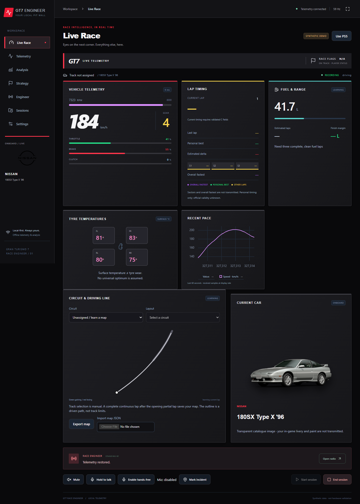

# GT7 Race Engineer

A local race engineer and telemetry dashboard for **Gran Turismo 7 on PS5**. Record laps, review driving data, hear offline engineer responses, and follow your car in a desktop window or browser.

**Start here:** [New-user guide](docs/USER_GUIDE.md) · [Windows beta](release/WINDOWS-BETA.md) · [Orange Pi installation](release/INSTALL.md) · [Local AI setup](docs/LOCAL_AI.md)



## Project status

This is an independent beta, not an official Sony or Polyphony Digital product. Live PS5 reception, Windows desktop rendering, offline speech recognition and audio playback have been exercised on the development PC. **Orange Pi 4 Pro 4GB performance and hardware compatibility still need on-device validation.** Advanced corner-by-corner coaching is incomplete.

The source contains the latest circuit maps, car panel, local AI and launcher fixes. Existing **1.3.0 release archives predate those additions**; use a source installation for them until a newer package is published. Download a complete release ZIP, not just its executable.

## Current features

| Area | Available now |
| --- | --- |
| Live receiver | GT7 A, B, ~ and C packet parsing; Salsa20 decoding; sender validation; packet ordering, duplicate and gap detection; reconnect and stale-data handling. Undocumented C interpretations remain opt-in. |
| Connection diagnostics | Receiver phase, actual variant, port-owner diagnostics, heartbeat and packet counters, errors, reception rate, and a nonintrusive 15-second field-coverage test. Heartbeat is configurable from 0.25–15 seconds. |
| Race viewer | Speed, RPM, gear, throttle, brake, clutch, fuel, timing, tyre surface temperatures, recent pace, connection status, player-status flag indicator, manufacturer identity and current-car panel. |
| Circuit library | 41 venues and 122 layouts, explicit selection, circuit logos or labelled original badges, direction and layout metadata. No guessed circuit name. |
| Track maps | Maps drawn from telemetry world positions; complete continuous laps saved per selected layout; retained full map plus a recent delta-colored driving line; bounded map JSON import/export. Maps represent the driven path, not official boundaries. |
| Car artwork | 574 local transparent official catalogue thumbnails mapped by car ID; manufacturer logos and a labelled generic fallback for missing images. Paint and custom livery are not transmitted. |
| Timing and delta | Lap timing, personal-best colors and estimated position-aligned delta to a clean recorded lap; manual reference selection. Green line means gaining, red means losing, gray means no usable reference. |
| Real-time analysis | Longitudinal acceleration, trailing coasting/pedal overlap, tyre temperature spread, braking episodes, quality and stale-data indicators. |
| Session analysis | Lap statistics, fuel consumption, consistency and pace summaries, driving observations, session reports, compatible spatial lap comparisons and braking analysis. |
| Strategy | Fuel reserve and race-length inputs, estimated fuel requirement/margin and saving target, pit intent, and **Unmark pit intent** / “stay out.” Estimates depend on suitable recorded laps and configured assumptions. |
| Race engineer | 100 request intents with three response forms each, searchable request library, typed commands, subtitles and radio controls. Priority, cooldown, expiry and rate limits manage automated calls. |
| Offline voice | Hands-free Vosk recognition, optional push-to-talk, speaker-feedback suppression, microphone retry, default or selected input/output devices, Windows system speech, eSpeak NG and optional Piper. Speaker, microphone and noise-calibration tests. |
| Local AI | Optional offline Qwen 0.5B quantized model ranks bounded, calculated observations. Two CPU threads, one inference at a time, memory/temperature/processing-pressure fallback. Calculated summaries remain available without the model. |
| Recordings | Full incoming sample recording through a bounded SQLite WAL writer, session recovery, partial/incomplete-lap tracking, source provenance, and visible loss counters. |
| Sessions and replay | Session library, metadata/notes/tags, protection, recorded-sample replay, pause, speed and seeking, manual end and interrupted-session reports. |
| Import and export | Session bundles with CSV/JSONL/HTML, bounded checksum-validated import, map JSON files; maintenance API supports retention previews, archiving and confirmed deletion. |
| Profiles and display | Track/setup profiles, dark/light theme, minimal dashboard, reduced motion and configurable UI refresh. Responsive desktop/mobile browser layout and fullscreen. |
| Platforms | Windows native window and browser launcher; Linux GTK/WebKit desktop and browser; ARM64 Ubuntu package targeting Orange Pi 4 Pro 4GB. |
| Privacy and access | Local backend, loopback binding by default, LAN pairing token and origin checks. No cloud account or API key. Microphone recordings are not retained; transcript display is optional and in memory. |

## Install from source

Use **Python 3.12** for the documented setup. Node 20.19+ is only needed to rebuild the UI; compiled assets are included. Install Git first if cloning; otherwise download and extract the repository ZIP. Run the commands from the project folder.

### Windows

```powershell
py -3.12 -m venv .venv
.\.venv\Scripts\python.exe -m pip install -r requirements-lock.txt -r requirements-voice.txt
.\.venv\Scripts\python.exe -m pip install pywebview
.\.venv\Scripts\python.exe scripts/download-model.py --accept-license
```

Install Microsoft Edge WebView2 Runtime if desktop mode requests it. Then double-click **Open desktop app.vbs** or **Open in browser.vbs** in the project folder. These launchers select `.venv` automatically and use the same `data` directory. If Windows disables VBScript, run:

```powershell
.\.venv\Scripts\pythonw.exe windows_app.py --desktop
# Or use --browser
```

For a telemetry-only browser server: `.\.venv\Scripts\python.exe run.py`. Voice needs the downloaded Vosk model selected in Settings. Packaged Windows releases already include their Python dependencies and Vosk model.

### Ubuntu / Orange Pi

```sh
bash scripts/install-ubuntu.sh
.venv/bin/python -m pip install -r requirements-voice.txt
.venv/bin/python scripts/download-model.py --accept-license
bash scripts/launch.sh --demo
```

Open **http://127.0.0.1:8000**. For the native ARM64 application, follow [the package guide](release/INSTALL.md). For source desktop prerequisites and service setup, see [INSTALL_ORANGE_PI.md](INSTALL_ORANGE_PI.md). The package targets ARM64 Ubuntu 24.04/Python 3.12; Android and 32-bit images are not supported by that package. Optional local AI has a separate [model/runtime installer](docs/LOCAL_AI.md).

## Your first drive

1. Put the PS5 and computer on the same reachable LAN. Find the PS5's current IP in its network settings.
2. Open **Settings**, enter that address under **PS5 IP**, and save. Keep the local bind at `0.0.0.0`, receive UDP port `33740`, and heartbeat destination port `33739` unless you have a specific network setup.
3. Select **Use PS5** if the synthetic demo is active. Start driving in GT7; menus may be silent.
4. In **Live Race**, select the circuit and exact layout. A map appears as you drive. Finish the opening partial lap, then a continuous full lap to save its outline.
5. In **Settings**, run **Test telemetry - 15 seconds** while driving. Check rate, valid packets, gaps and errors.
6. Use **Enable and test speaker**, then say “radio check.” Open **Engineer** for the request library. Hands-free listening is enabled by default; pause it for manual push-to-talk.
7. After driving, select **End session** to open analysis. Use **Sessions** to revisit, replay or export recordings.

The [new-user guide](docs/USER_GUIDE.md) walks through maps, voice, strategy, analysis, troubleshooting and backups.

## What telemetry cannot establish

GT7's player stream does not provide a dependable circuit ID, opponent leaderboard/radar, official race flags, race-wide fastest sectors, penalties, official lap validity, tyre wear/pressure or a confirmed race finish. Those facts remain unavailable. The flag panel shows **player status**, not fabricated green/yellow/red race-control flags. Tyre surface temperature is not tyre wear. Driver-path maps do not identify track limits or an ideal racing line. Saved layouts can be recognized after a complete clean lap; ambiguous routes require confirmation. Reference outlines are approximate and never supply track limits.

Map capture is bounded to 4096 points with approximately 10-metre spacing. Telemetry gaps, teleports and paused laps prevent saving a complete outline. The older live-delta alignment has a five-minute/1500-point lap limit; longer laps may still generate a map but have no live delta reference.

## Data, assets and privacy

Source installs store settings, recordings, logs and learned maps in `data/`; `--data` selects another folder. Packaged Windows uses `%LOCALAPPDATA%\GT7 Race Engineer`; packaged Linux uses `~/.local/share/gt7-race-engineer`. Use an unsynced local disk for SQLite recordings. Back up the whole data folder **after stopping the app**. Do not commit your recordings, control token, settings or downloaded AI models to GitHub.

The app runs offline after dependencies/models are installed. Circuit/car assets are local; the optional asset refresh script and model installers need internet. Car/track artwork belongs to its respective rights holders and is not covered by the metadata licence. [Asset provenance](docs/track-car-assets-provenance.json), [third-party notices](THIRD_PARTY_NOTICES.md), [protocol details](PROTOCOL.md) and [field capabilities](DATA_FIELDS.md) document sources and limitations.

Offline circuit geometry, including real elevation for 22 layouts, is built from jbhoorasingh/gt7-datalogger-track-data (CC0) and vthinsel/GT7Tracks (MIT); see [docs/TRACKS.md](docs/TRACKS.md) for what each source contributes.

## Development and verification

```sh
# Use .venv/Scripts/python.exe on Windows
.venv/bin/python -m pytest -q
.venv/bin/python run.py diagnostics
.venv/bin/python scripts/soak.py --seconds 30 --rate 60
cd frontend
npm ci
npm run build
npm run test:e2e
```

More checks, and where things live:

```sh
.venv/bin/python scripts/gen-contracts.py --check   # generated contracts (docs + frontend registries) are current
.venv/bin/python scripts/bench_ingest.py            # hot-path micro-benchmark; compare before/after touching ingestion
.venv/bin/python run.py run --demo --scenario packet_loss_burst   # deterministic synthetic scenario (never mixed with live data)
.venv/bin/python run.py run --safe-mode             # experimental features, mic, local AI and the console heartbeat stay off
cd frontend && npm run check:arch                   # components use src/domain clients, never fetch()
```

`pytest` on Windows may need `--basetemp=<a writable folder>` if the default temp directory is locked down.
Architecture: [ARCHITECTURE.md](ARCHITECTURE.md) is the map; [docs/architecture/](docs/architecture/) has the audit, per-area guides,
generated contracts and the tech-debt register; decisions are in [docs/adr/](docs/adr/). Adding a feature: [docs/architecture/EXTENDING_THE_APP.md](docs/architecture/EXTENDING_THE_APP.md).

Browser tests need a running **isolated test instance**, not your live recording data; see `frontend/playwright.config.ts`. The default browser is installed Chrome. A standalone `run.py connection-test --ps5 <address>` requires the normal receiver to be stopped first. Only one receiver may own the PS5 UDP port.

Bug reports should include OS/architecture, app version or commit, packet variant, steps to reproduce and relevant errors. Remove pairing tokens, personal paths and network identifiers before posting logs. Hardware measurements are welcome; synthetic tests are not proof of Orange Pi compatibility.

## Race Control development preview

The source build now includes league/event setup, group admission, driver forwarding, Race Control and a 26-template Broadcast Studio preview. This is not yet the completed release or included in the existing beta downloads. See [setup, implemented features and remaining validation](docs/RACE_CONTROL.md).

The Race Control preview now includes a **4/8/16-driver league demo**, a driver inspection/control desk, and side-by-side OBS preview/program monitors with drag placement and individual graphic outputs. Start it from **Race Control → Start rehearsal demo**; see the [OBS rehearsal guide](docs/RACE_CONTROL.md#league-demo-and-obs-rehearsal).

### Automatic track memory

Track recognition now remembers clean learned laps, keeps revision history, and asks for confirmation when identity is ambiguous. Includes 101 offline approximate reference outlines across the existing 122-layout catalogue, shared Race Control/OBS maps and session revision freezing. See the [track-memory guide](docs/TRACK_MEMORY.md) and [reference coverage report](docs/TRACK_REFERENCE_COVERAGE.md).

If the dashboard is stuck, use **Recovery** or open `/recovery`. See the [recovery guide](docs/RECOVERY.md).

The [broadcast graphics guide](docs/BROADCAST_GRAPHICS.md) lists all 26 graphics, their dimensions and sharing requirements, including the new classification strip, team roster, lap-time board, speed comparison, connection status and event information.
