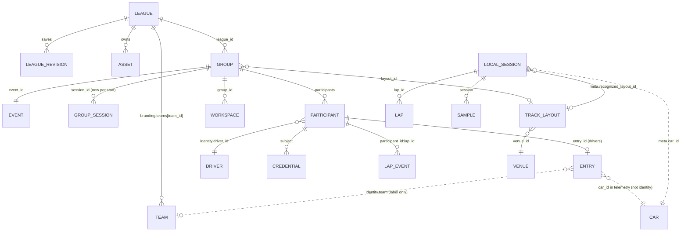

# Domain model: identity

Rule: every object that other objects refer to has an opaque, stable id that never changes when a human edits a
name. Names, numbers, colours and team labels are display attributes; never use them as keys.

## Identifiers

| Concept | Id | Created by | Stable across | Notes |
|---|---|---|---|---|
| League | `league.id` (uuid4 hex) | `GroupService.league_save` (`uid()` when no id given) | edits (each save bumps `revision` and writes a `league_revision` document under a fresh id) | Holds `branding` (logos, colours, sponsors, teams). Assets belong to a league (`asset.league_id`) |
| Event | `group.event_id` (uuid4 hex) | `GroupService.create_group` | all sessions of the group | Display name is `event_name`. The event id does not change when a new session starts |
| Group | `group.id` (uuid4 hex) | `create_group` | the whole event | Also the scope of every credential (`group_credentials.group_id`). Only one group can be active at a time ("Close current group first") |
| Group session | `group.session_id` (uuid4 hex) | `create_group`, and a **new** value on every `session_action('start')` | one run of the session | Frames (`group_frames`), events (`group_events`), lap acks and the `group_session` document are keyed by it. Publishers that still send an old value are rejected (`Identity or session mismatch`) |
| Local session | `Sessions.id` (uuid4 hex) | `Sessions.start` on the driver's PC | one continuous recording | Primary key of `sessions`; `samples.session`, `laps.session`, `events.session` refer to it. Independent of the group. A driver's packets carry it as `local_session_id` (`'idle'` when none) |
| Participant | `participant.id` (uuid4 hex) | `GroupService.join` | the group | Roles `driver` or `spectator`. Credentials name it as `subject`. Status `pending`, `admitted` or `removed` |
| Entry | `entry_id` (uuid4 hex) | `join`, only for role `driver` | the group | One car in the field. `entry.participant_id` says who currently drives it; the link is checked on every packet (`Publishing lease reassigned`). Race data (laps, gaps, flags, decisions, battles) is keyed by `entry_id`, never by number or name |
| Driver | `identity.driver_id` (max 64 chars) | client-supplied, otherwise `uid()` at join | as long as the client re-sends the same value | Person identity. Not a participant id: a client may reuse the same `driver_id` in another group |
| Team | `branding.teams[].team_id` | `group/migrations.ensure_team_ids` on league/group save and on document load | renames | See below |
| Car | `car_id` (int, GT7 car model) | GT7 telemetry field `car_id` | - | A car model, **never** a participant or entry. Looked up in `cars.py` (`data/cars.json`, keyed by `str(car_id)`); unknown ids give `Car <id>`, never a guessed brand |
| Track (venue) | `venue_id` (`'1'`, ...) | `data/tracks.json` | - | A venue has several layouts |
| Track layout | catalogue id (`'454'`, string, max 16 chars) | `data/tracks.json` -> `tracks.LAYOUTS`; the v3 bundle and `track_catalogue` use the same id as `layout_id` | - | The unit of comparison, recognition and maps. `GroupConfig.layout_id`, `Packet.layout_id`, `sessions.meta.recognized_layout_id` |
| Lap | `lap.id` (uuid4 hex) | `Sessions.start` and every lap boundary (`lap_id`) | - | Repeated lap *numbers* do not overwrite each other. Over the group protocol the driver client sends it with envelope id `'lap:' + lap.id` (dedup key) and tracks acks as `session_id + ':' + lap.id`; the host stores it as a `lap_event` document keyed `participant_id + ':' + lap.id` |
| Workspace / overlay | `workspace.id` (uuid4 hex) | `save_workspace` | - | An overlay credential's `subject` is the workspace id |
| Credential | SHA-256 of the token in `group_credentials.hash` | `repository.token` | until expiry or revocation | Roles: `driver` and `spectator` 7 days, `overlay` 30 days, invitations 60 s to 24 h. The token is never stored |

## Display attributes (mutable, never keys)

| Attribute | Lives in | Edited by |
|---|---|---|
| League `branding.name`, `short_name`, `tagline`, colours, logos, sponsors | league document | `league_save` (new revision each time) |
| Team `name`, `color`, `asset`, `slot` | `branding.teams[]` | league/group branding edit; `team_id` stays |
| Event `event_name`, group `name` | group document | `configure` |
| Identity `display_name`, `number`, `team`, `class_name`, `roster` | `participant.identity` and `entry.identity` | join form; race-desk entry edit (`entry` update, only `entry.identity` is changed) |
| Track and layout names | catalogue | app updates |
| Car name / manufacturer | `cars.json` | app updates |

Two facts to be aware of:

- `entry.identity` is a copy of `participant.identity` made at join. After a race-desk edit the two can differ; race
  views read `entry.identity`.
- `identity.team` is a free-text label. It is **not yet linked** to `branding.teams[].team_id`; team-scoped instructions
  (`scope == 'team'`) match by comparing `identity.team` with the instruction target string. `team_id` exists on the league
  side so that branding rows survive renames; linking entries to it is not built.

## team_id assignment (`group/migrations.py`)

`ensure_team_ids(teams, league_id)` runs when a league or a branding override is saved and when an older document is
upgraded on load (`upgrade()`, league and group schema 1 -> 2; written back lazily on the next commit). For each team row:

1. keep an existing `team_id`;
2. otherwise reuse the row's frontend `id` if it is a non-empty string, so both keys agree;
3. otherwise derive `uuid5(namespace, f'{league_id}:{name.casefold()}:{index}')`, so an in-memory upgrade gives the same
   id before and after write-back;
4. if the candidate collides with one already used in the list, derive a new one from the row position.

Group documents carry per-document `schema` numbers (`CURRENT_SCHEMA`: league 2, league_revision 2, group 2,
group_session 2, asset 2, workspace 1). A document from a newer app is returned untouched and a warning
`group_schema_newer` is logged.

## Relations

Solid lines are enforced keys; dotted lines are informational (`identity.team` is only a label, `car_id` is a telemetry
value).

## Where the identity is enforced

| Check | Code |
|---|---|
| A packet must match group, session, participant and entry, and the entry's current `participant_id` | `GroupService.telemetry` |
| A publisher stream is `(boot_id, local_session_id, session_id)`; an old stream is retired and cannot come back (max 64 changes per session) | same |
| Live and synthetic (`provenance`) sources cannot mix in one group | same |
| A lap is de-duplicated by its id, so retransmission is safe | `protocol._legacy_id`, `ReliableChannel.seen` |
| Comparison of two recorded laps requires equal provenance and equal `track`, `layout`, `direction`, `car_id` | `POST /api/compare` in `api.py` |
| Removing a participant revokes every credential whose `subject` is that participant and closes its socket | `GroupService.admit` |

Sessions restart the group session id, not the group id or the entry ids: a driver stays the same entry across the
practice, qualifying and race sessions of one event.
