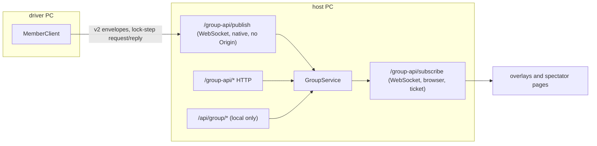

# Networking: the group protocol v2

Scope: the LAN "group" (a race-control host, drivers, spectators, OBS overlays). The local API and `/ws` to the
browser are described in `ARCHITECTURE.md` and `STATE_MANAGEMENT.md`. Decision record: ADR 0006. Code:

| File | Role |
|---|---|
| `backend/app/group/protocol.py` | Envelope, message registry, `decode`/`encode`, `negotiate`, `Codec`, `ReliableChannel`, `LegacyClientTracker`. Pure logic: no sockets, no fastapi, no asyncio |
| `backend/app/group/public.py` | The LAN listener app (adapter): HTTP guard, join, ticket, `/group-api/subscribe`, `/group-api/publish` |
| `backend/app/group/client.py` | `MemberClient`: the driver-side outbound connection |
| `backend/app/group/snapshots.py` | `SnapshotCache` |
| `backend/app/group/principals.py` | credential dict -> `core.permissions.Principal` |
| `backend/app/group/admin.py` | Local-only host administration (`/api/group/*`, behind the control token), starts and stops the listener |
| `backend/app/core/version.py` | `PROTOCOL_VERSION = 2`, `PROTOCOL_SUPPORTED = (1, 2)` |

## Channels

The host starts a second uvicorn server (`admin.py`, default port 8090, bind `0.0.0.0` or `127.0.0.1` only) that serves
`public_app`; it has no administration routes. The local API on its own port is never exposed by it (transport
isolation, see below).

## Envelope

Every v2 message is one JSON object, validated by `Envelope` (`extra='ignore'`):

| Field | Type | Meaning |
|---|---|---|
| `v` | int | protocol version of this message (2) |
| `type` | str, max 32 | a registered message type |
| `id` | str, max 100 | message id; generated when absent. Reliable messages use it for acks and deduplication; laps use `lap:<lap id>` |
| `ts` | float or str | sender clock when the envelope was built (epoch seconds) |
| `sender` | str, max 100 | `host`, or the client's boot id |
| `session` | str or null | group session id the message belongs to |
| `seq` | int or null | per-connection, per-direction counter set by `Codec`/`MemberClient` |
| `payload` | object | validated against the type's Pydantic schema; unknown keys are kept |

`encode()` validates the payload before building the envelope; `decode()` returns `Decoded(envelope, legacy)` and raises
`ProtocolError` with an HTTP-shaped status: 413 too large, 400 not a JSON object or bad envelope, 422 unknown type or bad
payload, 403 type not permitted for the role, 426 unsupported version (`protocol_incompatible`).

## Message types and reliability classes

From `MESSAGE_TYPES` (also generated into `docs/architecture/CONTRACTS.md`):

| Type | Class | May be sent by | Purpose |
|---|---|---|---|
| `hello` | ephemeral | driver, spectator, overlay, host | version and capability handshake |
| `telemetry` | ephemeral | driver | latest-wins packet |
| `ping` | ephemeral | driver, spectator, overlay | clock and latency probe |
| `clock` | ephemeral | driver | client clock offset report |
| `pong` | ephemeral | host | reply with host time and state |
| `state` | ephemeral | host | filtered group state, latest wins |
| `error` | ephemeral | host | sent before the connection closes |
| `ack` | ephemeral | host, driver | acknowledges a reliable message id (idempotent, so acks need no ack) |
| `lap` | **reliable** | driver | completed lap |
| `response` | **reliable** | driver | driver response or receipt |
| `instruction` | **reliable** | host | flag or instruction |
| `message` | **reliable** | host | race-control message |
| `decision` | **reliable** | host | steward decision |
| `workspace_taken` | **reliable** | host | a graphics draft went to program |

Ephemeral: latest wins, droppable, no retry; rate is set by the publisher (driver rate 1-10 Hz, default 5). Reliable:
carries an `id`, needs an ack, is retransmitted with backoff until acked or expired, and is deduplicated by `id` on the
receiver.

v1 ack names map onto the generic ack (`lap_ack` -> `ack` with `of: 'lap'`, `response_ack` -> `ack` with `of: 'response'`).

### What is actually reliable today

Read the code, not the table, for direction:

| Direction | Message | Mechanism in the code |
|---|---|---|
| driver -> host | `lap` | `MemberClient.outbox` (a `ReliableChannel`) retransmits with backoff until the host's reply carries the lap id; the host de-duplicates with `ReliableChannel.seen(id)` and replays the cached reply. Laps not yet acked are re-queued each cycle from the last 16 laps, so a lap is retried for as long as it stays in that window |
| driver -> host | `response` | queued in `MemberClient.responses` (`asyncio.Queue(64)`); on a failed exchange the item is put back and the connection is retried. Host side: dedup by id. The `ReliableChannel` outbox is **not** used |
| host -> driver | `instruction`, `message`, `decision`, `workspace_taken` | **Registered as reliable, but the host never sends them as standalone messages and has no server-to-driver outbox.** Race-control notices reach a driver inside the `state` payload that the host returns in reply to each `telemetry` and `ping` (flags and messages with `for_you`). The driver client de-duplicates them by `session_id:item id` and answers acknowledgements through `response {action: 'delivered'}` |
| host -> browser | `state` | ephemeral; a full frame every 0.2 s |

So the guarantee "reliable server -> driver delivery" is a property of the message registry and of `ReliableChannel`
(which supports both directions), not yet of the running host. Notices are delivered by polling: a driver that is
connected sees them within one exchange; one that is disconnected sees the current state on reconnect, not the missed
messages.

## Handshake and `negotiate`

1. Native driver connects to `/group-api/publish` with `Authorization: Bearer <token>` and **no** `Origin` header.
2. The host sends a flat greeting `{'type': 'hello', session_id, host_time, protocol: 2, app_version, server_capabilities}`.
   It is flat on purpose so v1 clients still parse it; the extra keys advertise v2.
3. A v2 client (`MemberClient.handshake`) sees `protocol >= 2` and sends an envelope `hello` with `ClientHello`:
   `protocol` (list, `SUPPORTED`), `app_version`, `capabilities` (`envelope-v2, ack, reliable`), `boot_id`. Timeout 10 s.
4. The host calls `negotiate(payload)`: the highest common version; `capabilities` are the intersection with
   `SERVER_CAPABILITIES` (`envelope-v2, ack, reliable, snapshot-cache`). No overlap, or a malformed hello, gives
   `compatible: false` with reason `protocol_incompatible: ...`.
5. On success the host replies with a `hello` (`ServerHello`: `protocol, app_version, compatible, reason,
   server_capabilities, session_id, host_time`) and switches its `Codec` to envelopes (`codec.v2 = negotiated >= 2`).
6. On failure the host sends `error {code: 'protocol_incompatible'}`, logs `protocol_incompatible` on the `network`
   logger, and closes with WebSocket code **4426**. The client raises `ProtocolIncompatible`, shows status
   `incompatible`, and retries only every 30 s.

`negotiate(None)` means "no hello" and yields a v1 negotiation while `1 in SUPPORTED`. The browser subscribe path has no
hello: v2 is opt-in with `protocol: 2` in the first message.

Other close codes: 1008 (policy: bad origin, credential, unknown message, oversize, any error in the loop), 1013 (too many
browser subscribers).

## v1 compatibility window

- Inbound flat messages (`{'type': 'lap', 'lap': {...}}`) are accepted by `decode()` and converted to an `Envelope(v=1)`;
  reliable v1 laps get a stable id (`lap:<lap id>`), so retransmissions de-duplicate. The service still works on flat
  bodies (`to_legacy`).
- `Codec` speaks flat v1 until the peer proves v2, then envelopes. A v1 host is used by the v2 client as-is (flat).
- When a v1 driver is seen on `/publish`, `LegacyClientTracker.note` logs once per client (LRU bounded to 512) at WARNING on
  the `network` logger: message `DEPRECATION: group protocol v1 client connected; v1 is removed after this release`,
  `event = protocol_v1_client`, with the role and a truncated client key. Credentials are not logged.
- Unsupported `v` in an envelope (not 1 or 2) raises 426 `protocol_incompatible` from `decode`.

Caveats to know before removing v1: dropping `1` from `PROTOCOL_SUPPORTED` makes `negotiate(None)` incompatible, but
`decode()` accepts flat messages without consulting `SUPPORTED`, and `/publish` does not call `negotiate` for a client that
never sends a hello. Removing v1 therefore needs a code change in `decode`/`publish`, not only the constant. The browser
subscribe path serves the unchanged v1 frame unless the client sends `protocol: 2`, and does not log a deprecation.

## `ReliableChannel`

No I/O; the transport owns the loop and the clock.

| Aspect | Behaviour |
|---|---|
| Sender | `send(id, message, ttl=None)`; idempotent for a queued id; refused (`dropped += 1`) at `outbox_limit` 256. `due(now)` returns messages whose `next_at` has passed |
| Backoff | delay `min(max_delay, base_delay * 2**attempts)` with base 0.5 s, cap 8 s, optional jitter function; `reset_backoff()` retransmits everything immediately (called after a reconnect) |
| Expiry | an item is dropped after `ttl` 60 s or `max_attempts` 12; `expired()` returns the ids given up on since the last call (the driver client does not read it, it re-queues laps from its own window instead) |
| Ack | `ack(id)` removes it |
| Receiver | `seen(id)` is true for a duplicate; ids are remembered in an LRU of `dedup_limit` 2048; `remember(id, reply)` caches the reply so a duplicate is re-answered without being processed twice |

## State sync and `SnapshotCache`

Driver connection: every `telemetry` and `ping` reply carries `public_state(principal)`; there is no separate subscription.

Browser connection (overlays, spectators, race-desk previews):

1. The authenticated page calls `POST /group-api/ticket` (cookie or bearer; overlay principals must match the workspace).
   The host returns a single-use ticket valid for 20 s (at most 512 pending).
2. The page opens `/group-api/subscribe` (its `Origin` must be on the host's allow-list) and sends `{ticket, protocol?}`
   within 5 s.
3. The host then sends the current full state immediately and again every 0.2 s: the frame itself when v1, or
   `encode('state', {'state': frame}, sender='host', session=..., seq=n)` when the client sent `protocol: 2`. Each frame
   re-authenticates the stored token, so revocation takes effect on the next frame.

There are **no deltas**: every frame is a full state (ADR 0006 mentions a snapshot followed by deltas; the running code
sends full frames). What the cache removes is repeated computation.

`SnapshotCache` (`group/snapshots.py`): keys must contain everything the value depends on. `GroupService.viewer_frame`
keys on `(viewer, group id, session id, revision, tuple(publication), delay, raw timeline)` where `viewer` is the
participant id for anyone who may see own telemetry (drivers see their own row) and the constant `'view'` for spectators
and overlays. Entries live at most 200 ms (one tick) and at most 64 are kept (LRU); `clear()` runs on every committed
group change (`revision` bump), so a change is never served stale. N overlays with the same view and delay share one
computation (`tests/test_protocol_v2.py::test_n_subscribers_share_one_snapshot_computation`); drivers never share
(`test_drivers_do_not_share_each_others_snapshot`). The host also keeps a bounded raw-frame history (up to 121 s, 650 frames,
64 MB) that produces delayed broadcasts, and records frames to `group_frames` through a 32-slot queue.

## Time and ordering

- `source_mono` is the driver's monotonic clock (meaningful only within one boot). `source_utc` is the driver's wall clock
  at the moment the packet was received (`time.time() - age`). `received` is the host's wall clock on arrival.
  Envelope `ts` is the sender's clock when the envelope was built and is informational.
- Clock offset: the driver measures a round trip with `ping`/`pong` (`host_time` in the pong), computes
  `uncertainty_ms = round trip / 2` and `offset_ms = (host_time - (sent + received) / 2) * 1000`, and reports it with
  `clock`. The host stores it per participant if `0 <= uncertainty_ms <= 60000`.
- `common_timeline(source_utc, received, offset_ms)` (`group/history.py`) gives the host's common timeline `T`:
  `source_utc - offset_ms/1000` with no extra uncertainty when an offset is known, otherwise the host receive time with 250 ms
  of extra uncertainty. Gap and interval calculations add the two cars' uncertainties and 50 ms (`gap_uncertainty`).
  Note: the client defines `offset_ms` as host minus client, and `common_timeline` subtracts it; its unit test uses an offset
  of 500 ms with `source_utc` 0.5 s ahead of `received` (`tests/test_group_history.py`), which reads as "client ahead of
  host". The two definitions look opposite; verify the sign convention before relying on sub-second gaps.
- Ordering: within one publisher stream `(boot_id, local_session_id, session_id)` the packet's own `sequence` decides; a
  packet whose `sequence` is not greater than the last accepted one is ignored (returns `accepted: false`), and a stream that
  has been replaced is retired and rejected (max 64 changes per session). Envelope `seq` is generated per connection and
  direction (`Codec.seq`, `MemberClient.wire_seq`) but the host does not read it today; ordering is by packet `sequence`,
  never by arrival.

## Security posture

| Concern | Control | Where |
|---|---|---|
| Message size | 32,768 bytes on `decode` (text, bytes and dicts alike) and `ws_max_size=32768`, `ws_max_queue=8`, no compression on the listener; HTTP bodies 64 KB (`Payload too large`, missing or invalid `Content-Length` rejected); the client accepts up to 2 MB from the host | `protocol.py`, `admin.py`, `public.py`, `client.py` |
| Field validation | strict Pydantic models with `extra='forbid'` for join/packet/config; telemetry `values` limited to an allow-list of 17 fields and finite numbers below 1e8; at most 40 values | `group/models.py` |
| Per-role allowlist | `ALLOWED_TYPES[role]` from `MESSAGE_TYPES`; `/publish` decodes with `role='driver'`; anything else is 403 -> close 1008 | `protocol.py`, `public.py` |
| Capabilities | every action is checked against `core.permissions` for the credential's principal (`principals.allowed`, `permitted_by`); the credential is re-authenticated on every publish message | `principals.py`, `service.py` |
| Rate limits | HTTP 300 per 10 s per client address; join 10 per 60 s per address; native publish 160 messages per 10 s per participant; telemetry 120 per 10 s per participant; 64 browser subscribers; 512 pending tickets | `public.py`, `service.py` |
| Idle | `/publish` closes when nothing is received for 15 s | `public.py` |
| Origin vs token | Browser channels need an allowed `Origin` **and** a credential (cookie `group_session`, `HttpOnly`, `SameSite=Strict`, or bearer). The native `/publish` channel must send **no** `Origin` (a browser cannot make that request) and needs the bearer token. Non-GET requests without an `Origin` must carry `Authorization`, except `join`. `Host` must be in the configured origin list | `public.py` |
| Host allow-list | hosting requires 1-16 explicit origins including the host address and port; bind only `0.0.0.0` or `127.0.0.1` | `admin.py` |
| Credentials at rest | only the SHA-256 of a token is stored (`group_credentials.hash`), with expiry and a `revoked` flag; removing a participant revokes its credentials and closes its socket | `repository.py`, `service.py` |
| Credential lifetimes | driver and spectator 7 days, overlay 30 days, invitations 60 s to 24 h, WebSocket tickets 20 s single-use | `service.py`, `public.py` |
| Never logged | the `network`/`system` logs record roles, ids and reasons, not tokens; `core/logging_setup.redact` masks values under keys such as token, credential, authorization, invite, cookie, fragment; the diagnostics bundle is redacted (`test_diagnostics_bundle_is_redacted`) | `logging_setup.py`, `diagnostics_report.py` |
| Overlay token | issued as a credential of kind `overlay` scoped to one workspace (`overlay.read`); the frontend builds the URL as `/overlay/<workspace>#access=<token>&graphic=...`. The fragment is not sent in HTTP requests, and client-error reports scrub it | `service.overlay_token`, `domain/api/graphics.ts`, `domain/clientErrors.ts` |
| Overlay media | `` requests cannot send headers, so `/media/<id>/<size>.png` accepts the credential as an `?access=` query parameter (or the cookie). It is a credential in a URL for those requests only; the listener runs with `access_log=False` and answers `Referrer-Policy: no-referrer` | `public.py`, `GroupGraphics.tsx` |
| Response headers | `nosniff`, `no-referrer`, `Cache-Control: no-store`, a strict CSP | `public.py` |
| Outbound client | the driver client uses no proxies, does not follow redirects, rejects host addresses with credentials, query, fragment or path, and caps host responses at 2 MB | `client.py` |

The group surface is plain HTTP/WS unless the host is put behind TLS; LAN use is not encryption (`INSTALL_ORANGE_PI.md`
and `TROUBLESHOOTING.md` in the repo root cover pairing). Tokens and overlay URLs must be treated like passwords.

## Transport isolation

`protocol.py` and `GroupService` know nothing about sockets. Transport code lives in `public.py` (host) and `client.py`
(driver); they decode into envelopes and hand plain dicts to the service. `public.py` deliberately contains no local
administration routes; those are in `admin.py` under the local API's origin and token checks. Any additional transport
(below) would replace or wrap only `public.py`/`client.py`.

## Where a relay transport would slot in (design note, nothing built)

A cloud or LAN relay would forward the same envelopes, so nothing above the transport changes:

- The relay would be a third transport next to `public.py` (host side) and `client.py` (driver side), speaking `encode`/
  `decode` with the same `MESSAGE_TYPES` allowlists, `negotiate` handshake and `ReliableChannel`.
- Identity travels in the envelope (`sender`, `session`) and the credential; the relay would authenticate the same
  hashed credentials or issue relay-scoped ones, and could not read or alter payloads it does not need.
- `SERVER_CAPABILITIES` is the extension point for new features (a relay would advertise e.g. an additional capability
  string; unknown capabilities are simply not in the intersection).
- Ephemeral types remain latest-wins, so a relay may drop and coalesce them; reliable types would keep `id`, ack and
  dedup end to end.
- What is missing for it: a server-side outbox for host -> driver reliable types (today only the receiver half runs on the
  host), an envelope-`seq` consumer, real delta or resume-from-seq state sync, and TLS.
