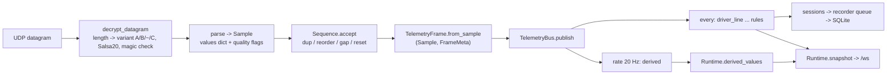

# Telemetry pipeline

Wire format: `PROTOCOL.md` (variants, encryption, corrections to upstream) and `DATA_FIELDS.md` (every field with offset,
type and caution). This file does not repeat them; it describes what the application does after the bytes arrive.

## Pipeline

Demo, scenario and replay frames join at `Runtime.consume`, after the parser: demo samples are built by
`parser.demo_sample` (which itself goes through `parse`), replay samples are rebuilt from the stored `values`.

## Raw vs normalized

| Stage | Object | Contents |
|---|---|---|
| Raw | the datagram (`bytes`) | Kept only when `settings.raw_capture` is on (`Sample.raw_hex`), or as `invalid_wire_hex` when a quality flag was raised |
| Decoded | `Sample.values` | Every `FIELDS` entry by name (offset table in `parser.py`), `None` for fields outside the variant's length, non-finite floats -> `None` with quality `<name>:nonfinite`, implausible speed/rpm/fuel/capacity -> `None` with `<name>:implausible`, negative timing/pre-race sentinels -> `None` |
| Normalized | extra keys added by `parse()` | `gear`, `suggested_gear`, `throttle`, `brake` (0..1), `speed_kmh`, `wheel_speed_kmh`, `wheel_speed_ratio`, `timing_raw_ms` (values before sentinel removal), `packet_id_signed`, `raw_nonfinite_fields`, `invalid_wire_hex` |
| Frame | `TelemetryFrame` | Two-slot wrapper: `sample` and `meta`; `frame.values` is the Sample's own dict (no copy, read-only by convention), `frame.get(channel_id)` |
| Derived | `DerivedEngine.evaluate(frame)` | `{channel_id: value}`; never written back into `values` |

`Sample` (slotted dataclass): `values, mono, utc, variant, provenance, quality, raw_hex, parser_version, wire_length`.
`mono` is the receive time (`time.monotonic`) taken before decoding; `utc` is the receive wall clock. `provenance` is
`live`, `demo` or `replay` and is stamped by the source, never by a consumer.

`FrameMeta` (NamedTuple, built once per packet on the 60 Hz path): `mono, utc, packet_id, variant, provenance,
parser_version, wire_length, quality, sequence_gap, duplicate, source_addr`. `sequence_gap` is the number of packets
missed immediately before this one (`None` if none or unknown). `duplicate` is always `False` for published frames:
`Sequence.accept` drops duplicates before publication and counts them in `Runtime.seq.counts`.

Ordering: `Sequence` orders `packet_id` as uint32 modulo 2^32. A duplicate is rejected; a backward id is rejected and needs
three consecutive increasing candidates to count as a reset (which ends the session as `interrupted`); forward deltas count
gaps. Counters (`duplicates, reordered, gaps, resets`) are in `snapshot.health.network` and the `telemetry_receiver`
service metrics.

## Channel registry (`telemetry/frame.py`)

`CHANNELS` is a `Registry[Channel]`. A `Channel` has `id` (identical to the `Sample.values` key and to the frontend id),
`name`, `group`, `unit` (canonical), `source`, `min_variant`, `accessor`, `color_role`, `formatter`, `availability` (a note,
or the reason a channel is missing), `sampling` (`full`, `ui`, `lap`).

| `source` | Meaning | Where it comes from |
|---|---|---|
| `reported` | decoded directly from a documented GT7 packet field | every `FIELDS` entry not in `EXPERIMENTAL` |
| `calculated` | derived by this app from reported fields | `_NORMALIZED` keys (`gear`, `throttle`, ...) and `DERIVED` channels |
| `experimental` | on the wire but undocumented or unverified upstream; the UI must label it | `EXPERIMENTAL`: `surface, current_ms, wheel_steering, wheelbase, category, unknown_a, unknown_t_bytes, unknown_t, torque_vectors, energy_recovery, acceleration_raw, steering_rotation` |
| `unavailable` | GT7 does not provide it; registered so the UI can say why | see the list below |

Current catalogue, as `GET /api/channels` returns it: 100 channels = 44 reported, 26 calculated, 12 experimental,
18 unavailable. (`CHANNELS` alone has 85; the endpoint merges the 16 derived channels and lets a derived channel win an id
clash, which is what happens to `speed_kmh`.) `channels.generated.ts` in the frontend and `docs/architecture/CONTRACTS.md`
are generated from the same data (`scripts/gen-contracts.py`); `tests/test_contracts_fresh.py` checks they are current.

### Reading `GET /api/channels`

A JSON array (pairing token required, like every `/api/*` route). Each row: `id, name, group, unit, source, min_variant,
color_role, formatter, availability, sampling`, plus `depends_on` (list) for derived channels. Callables are never
included. To know whether a channel can have a value for a given packet:

- `source == 'unavailable'` -> never; `availability` says why.
- otherwise variant order is `A < B < ~ < C`; the channel is present only if the packet variant is at least `min_variant`
  (`Channel.available_in`). A value can still be `null` for a valid reason (sentinel removed, implausible, dependency missing).
- `source == 'experimental'` -> show it labelled as such.

### Unavailable by design

GT7's UDP stream describes the player's own car only. These are registered as `unavailable`, with their reason, and must
never be shown as measured values:

| From `parser.UNSUPPORTED` ("Not established in the player-car UDP stream") | Added in `frame.py` beyond `UNSUPPORTED` (own reason each) |
|---|---|
| `leaderboard`, `opponents`, `penalties`, `tyre_wear`, `tyre_pressure`, `weather`, `official_lap_validity`, `race_finish`, `track_name`, `damage`, `understeer_diagnosis` | `race_position`, `gap_ahead`, `gap_behind`, `sector_times`, `race_flags`, `tyre_compound`, `lateral_g` |

The added reasons: race position, opponent gaps, official sector times, flag/safety-car state and fitted compound are not sent;
lateral G has no verified lateral acceleration in the packet. `Runtime.snapshot()` mirrors the same rule with
`race_flags = {available: False, reason: 'Not transmitted by GT7 UDP'}`. Group gaps and order are computed by the host from
shared driver telemetry and are labelled as estimates with uncertainty (see `docs/RACE_CONTROL.md`), never as GT7 data.

## Derived channels (`telemetry/derived.py`)

`DerivedChannel` extends `Channel` with `depends_on`, `compute(frame, state)`, `valid_when(frame)` and `state_factory`.
Contract: `compute` is pure given its state; each channel has its own state per `DerivedEngine`; a channel whose
dependency is `None`, whose variant is too old, or whose `valid_when` is false yields `None`; a channel that raises yields
`None` and increments `engine.errors[channel_id]`. `DerivedEngine.reset()` (new source, `Runtime.switch`) drops all state.

All 16 registered channels (all `source = calculated`):

| Id | Unit | Rule |
|---|---|---|
| `speed_kmh` | km/h | `speed * 3.6` |
| `wheel_speed_fl/fr/rl/rr` | m/s | `abs(wheel_angular * tyre_radius)`; `None` unless `0.05 < radius < 1` |
| `slip_ratio_fl/fr/rl/rr` | ratio | `abs(omega*r) / speed - 1`; `None` below 30 km/h, unless `abs(road_distance) < 0.25` (wheels on the ground), unless `abs(yaw rate) < 0.15 rad/s`, and unless the radius is plausible. A ratio, not proof of tyre slip |
| `longitudinal_g` | g | speed derivative divided by 9.80665, recomputed at most every 0.19 s (about 5 Hz, as `live_analysis`), held between; only while on track (`flags & 1` and not `flags & 6`); state restarts after a 0.5 s gap, a backwards clock, or a change of `(provenance, car_id, lap)` |
| `throttle_brake_overlap` | bool | `throttle > 0.1 and brake > 0.1` |
| `steering_rate` | rad/s | reported `steering_velocity`; needs variant B or newer |
| `fuel_per_lap` | L | litres burned over the last completed lap that was seen from its first frame and had no refuel (a rise above 0.2 L marks a refuel); held until the next lap; `None` when the lap was joined part-way or is not positive |
| `delta` | s | placeholder: `valid_when` is always false here; the live delta is produced by `LiveDelta` (`snapshot.live_delta`) |
| `brake_release_rate` | 1/s | `-(d brake / dt)`, positive while releasing; clamped to +/-20; `None` if `dt <= 0` or `dt > 1 s` |
| `throttle_application_rate` | 1/s | `+(d throttle / dt)`, same clamp and gap rule |

Evaluation cadence: the bus subscription `derived` uses `mode='rate', hz=20`, decided from `frame.meta.mono`, so the engine
runs at most 20 times per second instead of on all ~60 packets. The code does not state a reason beyond the clamp
comment ("full travel in 50 ms" is `1/20 s`); the practical effect is that the work stays off most of the 60 Hz path and
the pedal rates are finite differences over about 50 ms. The results are only the latest values in
`Runtime.derived_values` (`snapshot.derived`); they are not recorded, and recorded analysis does not depend on them.

## Units

Canonical, internal and stored: m/s, m, degrees C, L, bar, s, rad, rad/s, rpm. Everything on the bus, in SQLite and in the
API is canonical; conversion to the driver's preference happens at the edge.

| Kind | Canonical -> options | Backend | Frontend |
|---|---|---|---|
| speed | m/s -> `kmh`, `mph` | `telemetry/units.py: speed, speed_to_ms` | `frontend/src/domain/units.ts` |
| temperature | C -> `C`, `F` | `temp, temp_to_c` | same |
| fuel | L -> `L`, `gal_us`, `gal_uk` | `fuel, fuel_to_l` | same |
| distance | m -> `m`, `km`, `mi` | `distance, distance_to_m` | same |
| pressure | bar -> `bar`, `psi` | `pressure, pressure_to_bar` | same |

`None` passes through unchanged; an unknown unit raises `ValueError` (backend) or `Error` (frontend). `units.label(kind,
unit)` and `spoken_speed` serve display and speech. The user's choice is `Settings.units` (schema 2) on the backend and
`localStorage` `ui:v1:units` in the browser, which is view state (STATE_MANAGEMENT.md). `wheel_speed_kmh` and `speed_kmh`
in `Sample.values` are km/h by name; the derived `wheel_speed_*` channels are m/s.

## Packet variants and isolation

| Variant | Length | First fields |
|---|---|---|
| A | 296 | base block (position ... `car_id`) |
| B | 316 | `steering_rotation, steering_velocity, acceleration_raw` |
| `~` | 344 | `throttle_filtered, brake_filtered, torque_vectors, energy_recovery`, unknowns |
| C | 368 | `surface, current_ms, wheel_steering, wheelbase, category` |

Isolation rules, all in code:

- `FIELDS` carries the first variant of every field; `parse()` writes `None` for any field whose `offset + size` exceeds the
  datagram length, and builds a **new** `values` dict per packet, so a variant A packet can never inherit a C field from an
  earlier packet.
- `Channel.min_variant` is copied from `FIELDS`; `DerivedEngine` returns `None` for a channel when the frame's variant is
  older than the channel's.
- Variant is determined by the received length only; there is no probing (`PROTOCOL.md`).
- Interpreting C fields as validated is opt-in (`trust_c_fields`, feature flag `packet_c_interpretations`, off by default):
  it gates `current_ms` use in session timing and one engineer rule. The parser always decodes them, and the channel
  registry labels them `experimental` regardless.
- The heartbeat variant letter is `Settings.variant`; the default heartbeat interval in code is 1 s
  (`core/defaults.HEARTBEAT_S`).

## Sources

`source_loop` selects on `Runtime.source`:

| Source | `provenance` | Network | Notes |
|---|---|---|---|
| `live` | `live` | binds `udp_bind:udp_port`, sends the heartbeat to `ps5_ip:remote_port`, accepts only datagrams from `ps5_ip` | no heartbeat in safe mode or host-only mode |
| `demo` | `demo` | none | free-running `demo_sample` at 60 Hz, or a scenario when `Settings.demo_scenario` is set |
| `replay` | `replay` | none | reads stored samples from SQLite with their original spacing (capped at 2 s), speed and pause controls |

Invariants (ADR 0003, enforced in code and tests): demo and replay never send a heartbeat and never write live track maps,
personal bests or the training corpus; group publishing refuses to mix `live` and `demo` sources.

`TelemetrySource` (`telemetry/sources.py`) is a `runtime_checkable` Protocol: `kind` and `status() -> ServiceStatus`, with an
optional `ReplayControls` protocol (`pause, resume, seek, set_speed`). It is the target contract; no runtime class
implements it yet, `source_loop` still switches inline, and the receiver phase is exposed through the
`telemetry_receiver` service.

### Deterministic scenarios (always SYNTHETIC)

`ScenarioDemo(seed, hz=60, base_mono=1000).run(name)` yields `ScenarioItem(mono_offset_s, packet_id, sample)` in delivery
order. Same seed, rate and base give identical output (timestamps come from a fixed epoch, never the wall clock).
`sample=None` means the stream closed.

| Scenario | What it produces |
|---|---|
| `normal_laps` | two clean 30 s laps at full rate |
| `lap_transition` | six seconds spanning lap 1 -> 2 |
| `fuel_burn_and_refuel` | 2.5 L/lap burn for three laps, then +20 L mid-lap 3 |
| `braking_zones` | three 1.5 s braking zones |
| `packet_loss_burst` | ten seconds with two loss bursts (30 and 12 packets) |
| `out_of_order` | every 20th pair of packets delivered swapped |
| `stream_stale_10s` | 3 s of packets, 10 s silence, 3 s more |
| `session_end` | 3 s driving, 1 s paused, then the stream closes |
| `variant_switch_A_to_C` | 2 s of variant A (296 B) then 2 s of variant C |

Select one:

- CLI: `python run.py --demo --scenario NAME` (`--scenario` requires `--demo`; an unknown name is a parser error that lists
  the choices).
- Settings: `Settings.demo_scenario = "NAME"` (validated against `SCENARIOS`; `""` means the free-running demo). The
  scenario only runs while the source is `demo`.
- Code: `Runtime._scenario_step` builds `ScenarioDemo(seed=0).run(settings.demo_scenario)` on first use, sleeps until each
  item's offset, skips `sample=None` items (a deliberate silent gap), and passes every packet through the same
  `Sequence.accept` as live packets, so gap, reorder, reset and stale scenarios exercise the real ingestion logic. When the
  iterator ends the receiver phase becomes `demo_scenario_complete`; switching source resets it.
  `GT7_DEMO=1` at startup switches to the demo source.

## Bus (`telemetry/bus.py`, ADR 0002)

Synchronous and in-process; `publish` runs on the ingestion path, so handlers must be cheap.

| Mode | Behaviour |
|---|---|
| `every` | called inline for every frame |
| `rate` (`hz`) | called at most `hz` times per second, decided from `frame.meta.mono`; the first frame always passes; a clock that goes backwards restarts the cadence |
| `latest` | nothing is called; the newest frame is kept in a slot the consumer pulls (`subscription.latest(only_fresh=...)`). The Runtime does not use this mode yet |

- **Order**: subscribers marked `critical` first, then subscription order. No Runtime subscriber is critical today
  (TECH_DEBT #14).
- **Names** are unique per kind (frame or event); a duplicate raises `ValueError`.
- **Error isolation**: a handler exception is caught, counted in `SubscriberMetrics.errors`, kept as `last_error`, logged at
  most once per 60 s per subscriber (`telemetry` logger) and reported through `on_error`. `Runtime._pipeline_error` counts a
  pipeline error, sets `receiver.last_error` and adds the session quality flag `application processing failure`. Delivery to
  the remaining subscribers and ingestion continue. `ingest_datagram` is a second boundary for parse and sequence errors.
- **Events** (`emit(TelemetryEvent(kind, data, mono))`, handlers registered with `subscribe_events(kinds=...)`):
  `lap_completed, session_started, session_ended` (from `Sessions.emit`), `source_changed` (`Runtime.switch`),
  `connection_changed` (`connected`, `restored`, `stale`, `interrupted`), `track_locked`, `track_unlocked`, `pit_detected`.
  The application currently registers no event subscribers; the events exist for tests and for consumers to attach.
- **Metrics**: `bus.metrics_snapshot()` -> `frames_published`, `events_emitted` and, per subscriber, `mode, hz, critical, calls,
  errors, last_error, p95_ms` (every 16th call is timed into a 256-sample window). It is included in `GET /api/diagnostics`
  under `bus`.

## The truthfulness rule

The application reports what the player-car stream contains and labels everything else.

- A value is `reported`, `calculated` (with the rule above), `experimental` (labelled) or `unavailable` (with the reason).
  Nothing is inferred beyond the packet: if a dependency is missing or the maths would be meaningless, the value is `null`,
  not a guess.
- GT7 does not send: opponent data, race position, gaps, official sector times, official lap validity, flags, penalties,
  tyre wear, tyre pressure, tyre compound, weather, damage, track name, race finish. Official lap validity is always
  `unknown`.
- Constant oil and water temperatures do not raise overheating alerts; pre-race position and car count are raw channels, not
  standings; wheel speed ratios are not slip measurements.
- Demo, scenario and replay data keep their own `provenance` everywhere, including on the group wire, and the UI labels
  them synthetic or replayed.
- Hardware validation: layouts are source-verified against the pinned upstream header; no captured PS5 datagram is claimed
  (`PROTOCOL.md`).
